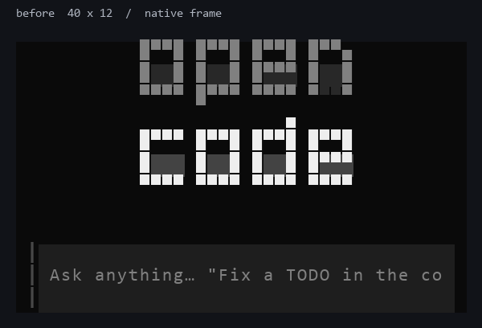
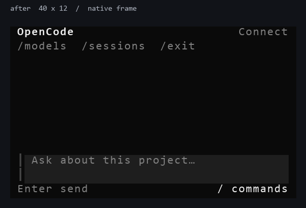

# OpenCode iOS

在越狱 iPhone 的终端里运行 **OpenCode v2 与真正的 OpenTUI 全屏界面**。
项目面向 Dopamine rootless，安装路径为 `/var/jb`；支持 NewTerm 和 SSH 真 TTY。

Node.js 独立打包：**包名 `node26`，版本 `26.13.0-1`，命令 `node`，作者 `nodejs`**。
OpenCode 精确依赖它，不再内嵌另一份 Node。稳定版 `v2.2.5-ios.5` 保留原有 Node 22
与行式 REPL，实验版提供完整 TUI，两条发布线分开记录。

## 版本与验证

| 内容 | 当前已验收工件 |
| --- | --- |
| 独立 Node.js | `node26` `26.13.0-1`，[run 41620234785](https://github.com/Justintunsday/nodejs26-ios/actions/runs/41620234785) |
| OpenCode | `2.2.5-4` / `node26test.7`，[run 41642851035](https://github.com/Justintunsday/opencode-ios/actions/runs/41642851035) |
| 设备 | iPhone SE 2、iOS 16.1.1、Dopamine rootless |
| 实测 | CLI 8/0；窄屏缩放与 Unicode 草稿；121.600 秒真实 PTY 三轮工具会话、终端恢复与 `/exit` 返回 0；帧流 DECSET 2026 计数 0/0，空闲窗口 0 B |
| 整屏闪烁修复 | 设备终端为 **EverTerm 1.5-2**；用户 A/B 确认旧版每个 2026 同步帧都会整屏闪。iOS 现不发送 2026 包络，功能 DEVICE-VERIFIED；官方包肉眼复核已请求 |

完整 SHA-256、退出码、原始 PTY 摘录和系统 Jetsam 记录见
[移动 TUI 验收](docs/MOBILE_TUI_DEVICE_RESULTS.md) 与 [独立运行时验收](docs/NODE26_EXTERNAL_DEVICE_RESULTS.md)。CI 负责构建与静态检查，
真机结论来自实际设备命令；其他设备与系统版本尚未验收。

## 运行要求

- arm64 越狱 iPhone，rootless `/var/jb`，Procursus `dpkg`。二进制部署目标为 iOS 15.0。
- UTF-8 真终端；移动布局最低 **24 列 × 8 行**，建议至少 40 × 12。
- 独立 `node26` 运行时包。启动器自动添加必需的 `--single-threaded`。
- Git 工具需要另外安装 `git`；模型服务需要自己的账号或 API key。

## 下载与安装

在已登录 GitHub CLI 的电脑下载工件，内含两个 deb、报告与校验和：

```sh
gh run download 41642851035 -R Justintunsday/opencode-ios \
  -n opencode-ios-rootless-node26 -D opencode-ios
```

将整个工件目录传到手机，在该目录执行：

```sh
sha256sum -c SHA256SUMS
sudo dpkg -i node26_26.13.0-1_iphoneos-arm64.deb OpenCode-iOS-rootless-node26.deb
node --version
node -p 'process.platform'
opencode --version
cd /var/mobile/Documents
opencode
```

预期 Node 输出 `v26.13.0` 与 `ios`。旧 `nodejs26-ios` 原型包如仍安装，需要先移除；
新版对外命令是 `node`。配置、凭据和会话存放在用户目录，包升级会保留它们。
详细的升级、回退及卸载方法见 [安装文档](docs/INSTALL.md)。

## 手机操作

在 TUI 输入 `/connect` 配置模型服务，再用 `/models` 选择模型。
未配置真实服务时仍可打开界面和使用本地 CLI；本项目的自动化代理验收使用本地模拟服务。

| 操作 | 按键或命令 |
| --- | --- |
| 发送 | Enter |
| 输入换行 | Ctrl+J；支持扩展键盘的终端也可用 Shift+Enter |
| 查找操作 | 输入 `/`，方向键选择，Enter 确认 |
| 关闭菜单 / 中断 | Esc；按当前界面提示操作 |
| 切换模型 | `/models` |
| 历史会话 / 新建 | `/sessions` / `/new` |
| 退出 | `/exit` 后 Enter |

移动布局收起大字 Logo，首页保留状态和常用命令，输入区固定在底部；
窄屏对话使用单栏与较小边距。屏幕旋转、软件键盘缩小高度时重新排版，保留未发送草稿。
过小窗口显示尺寸提示，恢复尺寸后继续编辑。

40×12 的 OpenTUI 原生测试帧对比（电脑字体绘制，非手机截图）：

| 改版前：输入区被大字 Logo 挤出 | 移动布局：输入与操作提示完整可见 |
| --- | --- |
|  |  |

## 渲染与终端（EverTerm / NewTerm）

iOS 渲染策略限制为 20 帧/秒并合并更新，且**不再发送 DECSET 2026 同步输出帧**。
设备实际终端是 **EverTerm 1.5-2**（不是 NewTerm）：它把每个同步输出块当作一次全屏 present，
所以旧版每个变化帧都会整屏闪一下。用户 A/B 已确认去掉 2026 包络后闪烁消失；
新版帧流中 2026 begin/end 为 **0/0**，空闲窗口仍为零输出，
官方 `node26test.7` 安装后的最终肉眼复核已请求。
默认关闭界面动画，使用不闪烁的线形光标；显式设置的动画与光标偏好仍会保留。
扩展键盘协议为可选能力，iOS 使用基础按键路径。

- 更新后先在旧界面 `/exit`，再运行 `opencode`，让进程加载新版代码。
- 若报 `EADDRINUSE`，可用 `opencode --standalone` 启动私有服务；不同账户应使用不同服务端口。
- 不要移除启动器的 `--single-threaded`。iOS JIT 的 W^X 权限切换作用于整个进程。
- 渲染库必须保留在 `/var/jb/usr/lib/opencode/cli/assets`，并保持原始签名。
- 非 TTY 运行会给出指引并返回 1；脚本使用 `opencode run --standalone "任务"`。

```sh
opencode --version
opencode models --standalone
opencode debug paths
opencode run --standalone "说明当前项目结构"
```

## 已知限制

Node 用户 `worker_threads` 不受支持；iOS 禁用 tree-sitter 后台 worker，代码块使用纯文本
回退。运行时包不含 npm/npx。剪贴板、交互式工具 PTY、Ghostty 面板与音频未提供完整验收。
中文、emoji、组合字符按显示宽度排版；Arabic/RTL 保留逻辑文本，最终塑形与双向显示取决于终端。

SE 2 的内存有限，多开 TUI 与服务会增加压力。此前已观察到系统 Jetsam 日志，
因此功能通过不代表无限期稳定运行。真实外部模型认证、计费与网络行为需要按服务商另行验证。
完整范围见 [已知限制](docs/KNOWN_LIMITATIONS.md)。Node 的 JIT/wasm 与原生文件、sysctl、
exec/spawn、POSIX 共享内存和命名信号量测试为 19 PASS / 2 UNSUPPORTED；
[报告](https://github.com/Justintunsday/nodejs26-ios/blob/main/docs/POSIX_JIT_WASM_DEVICE_RESULTS.md)
记录 `sem_init` 的 ENOSYS 和 System V `shmget` 的 SIGSYS。

## 开发与构建

上游版本固定在 [UPSTREAM.lock](UPSTREAM.lock)，iOS 修改以补丁维护。
Node 运行时位于独立仓库 [nodejs26-ios](https://github.com/Justintunsday/nodejs26-ios)。
UI 调整复用现有 Solid/OpenTUI 架构，设计参考
[pageton/tui-design-skill](https://github.com/pageton/tui-design-skill)。

| 工作流 | 用途 |
| --- | --- |
| `build-opencode.yml` | 构建 JS CLI 与移动 TUI，运行主机测试 |
| `build-opentui-ios.yml` | 构建并签名 iPhoneOS 原生渲染库 |
| `package-rootless-node26.yml` | 生成依赖独立 Node 的 OpenCode deb，校验两个包 |
| `package-rootless.yml` | 保留稳定 Node 22 发布线 |

```sh
gh workflow run build-opencode.yml -R Justintunsday/opencode-ios -f variant=node26
```

验收覆盖布局快照、基础按键、粘贴、Unicode、缩放保留草稿、空闲输出、帧同步与终端恢复，
随后在 iPhone 真 PTY 验证。构建细节见 [OPENCODE_BUILD.md](docs/OPENCODE_BUILD.md)，
渲染库要求见 [OPENTUI_IOS.md](docs/OPENTUI_IOS.md)。

## 许可

这是独立移植项目。OpenCode、Node.js、OpenTUI 的版权与许可保留原作者归属；
详见 [LICENSE](LICENSE) 与 [NOTICE](NOTICE)。
